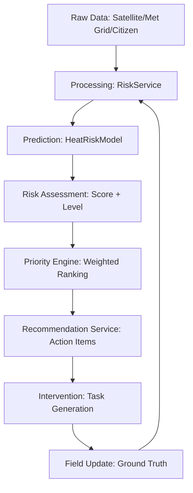

# UrbanSense AI — Software Requirements Specification (SRS)

## 1. Requirements

### Functional Requirements

- **FR-1: Role-Based Access Control (RBAC)**: The system shall support four distinct roles: Citizen, Analyst, Field Officer, and Administrator, each with a specialized dashboard.
- **FR-2: Urban Risk Mapping**: The system shall provide an interactive city map displaying schematic ward boundaries and risk hotspots.
- **FR-3: Predictive Risk Calculation**: The system shall calculate risk scores (0-100) using a multi-factor engine (temperature, density, vegetation, etc.).
- **FR-4: Priority Ranking**: The system shall automatically rank urban zones for intervention based on risk severity, population load, and vulnerability.
- **FR-5: Observation Reporting**: Citizens shall be able to submit location-based environmental anomalies with descriptions and categories.
- **FR-6: Task Management**: Field Officers shall be able to receive, update, and commit evidence for assigned intervention tasks.
- **FR-7: System Alerts**: Administrators shall be able to broadcast critical alerts across the platform.

### Non-Functional Requirements

- **NFR-1: Responsiveness**: The UI shall be fully responsive across mobile (390px+), tablet, and desktop (up to 1920px).
- **NFR-2: Reliability**: Data shall be persisted on the server, ensuring state survival across restarts.
- **NFR-3: Performance**: The interactive map shall remain fluid (60fps) during zone selection and filtering via memoization.
- **NFR-4: Maintainability**: The codebase shall follow a modular architecture with separate layers for services, models, and UI.

### Security Requirements

- **SR-1: Authentication**: All access to dashboards shall require a verified session via secure HttpOnly cookies.
- **SR-2: Authorization**: API endpoints shall verify user roles before returning sensitive city data.
- **SR-3: Input Sanitization**: All user-generated content (names, observations) shall be sanitized to prevent XSS.
- **SR-4: Data Integrity**: Server-side validation (Zod) shall be enforced for all incoming data packets.

### Performance Requirements

- **PR-1: API Latency**: Core intelligence APIs (risks/zones) should respond within <200ms in standard conditions.
- **PR-2: Resource Loading**: Use of skeleton loaders to maintain perceived performance during data fetching.

### Accessibility Requirements

- **AR-1: Dual-Mode Indicators**: Risk levels must be identifiable via both color and icons/labels for color-blind users.
- **AR-2: Semantic HTML**: Use of proper ARIA labels and landmarks for screen reader compatibility.

---

## 2. User Stories

### Citizen

> "As a citizen, I want to see the current risk level around my area so that I can understand potential environmental risks and take safety precautions."

### Analyst

> "As an analyst, I want to analyse historical and predicted risk patterns so that I can identify emerging hotspots and simulate 'what-if' mitigation scenarios."

### Field Officer

> "As a field officer, I want to receive prioritised intervention tasks so that I can focus on the most critical areas first and provide ground-truth evidence."

### Admin

> "As an administrator, I want a city-wide risk overview and automated prioritization so that I can allocate resources effectively across the municipality."

---

## 3. Acceptance Criteria

### Interactive Risk Map

- **AC-1**: Map markers must change color dynamically based on real-time risk scores.
- **AC-2**: Selecting a zone must open an intelligence panel with detailed risk drivers.
- **AC-3**: Search function must accurately navigate and auto-select zones by ID or name.

### Priority Engine

- **AC-1**: Priority scores must be derived from at least 5 factors (Severity, Exposure, Frequency, Confidence, Vulnerability).
- **AC-2**: A change in any weighted factor must reflect in the "Intervention Matrix" ranking instantly.

### Authentication Flow

- **AC-1**: Successful login must redirect users to their role-specific home route.
- **AC-2**: Unauthorized URL access must trigger a "Permission Denied" toast and redirect to an authorized sector.

---

## 4. Architecture Documentation

### Frontend (React 19 + TanStack Start)

- **Layouts**: `PublicLayout` for landing/public map; `AppLayout` for command-centre dashboards.
- **Components**: Atomic UI units (shadcn) + Feature-specific modules (`/analytics`, `/maps`).
- **State Management**: Context-based `AuthContext` and `AppStore` for global operational state.

### Backend (Nitro Server)

- **API Layer**: RESTful endpoints under `/api/*` for auth, data, and analytical operations.
- **Repository Pattern**: `UserRepository`, `ZoneRepository`, etc., abstraction over persistence.

### Database (JSON/Persistent File System)

- **JsonDb Engine**: A custom implementation managing structured collections (users.json, zones.json, etc.) in the `.data/` directory.

### Risk Engine (Modular)

- **BaseRiskModel**: Interface defining standard calculation signatures.
- **HeatRiskModel**: Implementation for urban heat load analysis using weighted environmental telemetry.

### Recommendation Engine

- **RecommendationService**: Maps risk levels and zone vulnerability to specific municipal action items and safety directives.

---

## 5. Data Flow

1. **Ingestion**: Raw telemetry is ingested via simulated service layers.
2. **Analysis**: `RiskService` orchestrates data through the appropriate `RiskModel`.
3. **Forecasting**: Momentum logic predicts scores for the next 72-hour window.
4. **Prioritization**: `PriorityService` calculates a composite score for city-wide ranking.
5. **Mobilization**: `InterventionRepository` creates tasks for high-priority sectors.

---

## 6. Testing Strategy

- **Unit Tests**: Coverage for `HeatRiskModel` and `PriorityService` logic in `src/tests/`.
- **Integration Tests**: Verification of `RiskService` aggregation of multiple models.
- **API Tests**: Postman/Fetch verification of `/api/*` endpoint schema and RBAC enforcement.
- **UI Tests**: Manual walk-through of every dashboard interaction (buttons, forms, searches).
- **Responsive Audit**: Breakpoint testing at 390, 768, 1024, 1440, and 1920 pixels.

---

## 7. Future Expansion

UrbanSense AI is architected for "Plug-and-Play" risk intelligence:

- **Urban Heat**: Current implementation (Active).
- **Flood Risk**: Implement `FloodRiskModel` (Hydrology + Rainfall vectors).
- **Air Quality**: Implement `AQIRiskModel` (Pollutant corridors + Population proximity).
- **Waste Risk**: Implement `WasteRiskModel` (Collection gap analysis).
- **Infrastructure**: Implement `AssetRiskModel` (Stress telemetry on ageing utilities).

All models can use the existing `PriorityService` and `Intervention` workflows by simply implementing the `RiskModel` interface.
